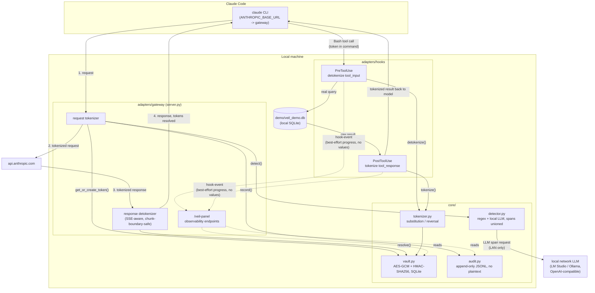

# veil-pii-middleware

PII sanitization middleware for [Claude Code](https://claude.com/product/claude-code), built
around a tokenization / de-tokenization cycle. Raw personal data never leaves the machine in
clear text towards an external API, while local tools — database queries, file reads — keep
operating on the real values.

---

## 1. What this is, and why

Target scenario: a developer uses Claude Code to diagnose a production incident.

> "Customer customer1@project.com has a problem with their invoices. Can you check the
> database for errors, look at the logs, and tell me what happened?"

Without protection, this sends to Anthropic's API: the email in the prompt, and then every
row the database query returns — names, national IDs, IBANs, phone numbers, support-ticket
bodies, stack traces. Column-level masking in the database does not solve this, because PII
also lives in free-text fields, JSON payloads and log lines, not just in columns named
`email` or `national_id`.

**Architectural requirement: zero transmission of raw PII to an external API.**

The approach: intercept traffic at the points where it leaves the machine or reaches a local
tool, run every string leaf through a hybrid PII detector, and replace each match with a
stable `PII_<TYPE>_<NNNN>` token (e.g. `PII_EMAIL_0001`). The real value is stored once,
encrypted, in a local vault keyed by that token. Anything a local tool needs to act on (a SQL
query, a file) gets the token resolved back to the real value just before it runs; anything
headed to the model or the screen only ever sees the token, or — for the human, on screen —
the value resolved back for display.

This is a demonstration/portfolio project, not a hardened production system. Its threat model,
scope and known gaps are documented explicitly below rather than glossed over.

---

## 2. Stack

- **Language:** Python, `requires-python = ">=3.11"`. Developed and verified against Python
  3.12.10.
- **Runtime dependencies:** `cryptography` (AES-GCM for the vault), `httpx` (the gateway's
  forwarding HTTP client). Nothing else — no web framework, no ORM, no queue.
- **Dev tooling:** `ruff` (lint + format, `E,F,I,UP,B,SIM` at line length 100, double quotes),
  `mypy --strict`, `pytest`, `build`/`hatchling`, `faker` (demo corpus generation only, never
  on the data path).
- **Build backend:** Hatchling, via `pyproject.toml`. `pip` + `venv` for dependency management,
  no lockfile tooling.
- **Storage:** SQLite for the vault and the demo database — no server process, queried directly
  by Claude Code over `Bash` (or Python's `sqlite3` module where the CLI binary isn't
  installed).
- **Local LLM:** any host serving an OpenAI-compatible `/v1/chat/completions` endpoint (LM
  Studio, Ollama, ...). Verified live against LM Studio on a LAN machine running
  `qwen_qwen3-4b-instruct-2507`. The base URL and model are always environment configuration
  (`VEIL_LLM_BASE_URL`, `VEIL_LLM_MODEL`), never a hardcoded host.
- **Frontend:** one static, unbuilt HTML file (`frontend/panel.html`) — React + Babel Standalone
  loaded from CDN, no bundler, no new dependency, served directly by the gateway process.

Install:

```bash
python -m venv .venv
.venv/Scripts/activate        # Windows; `source .venv/bin/activate` on POSIX
pip install -e ".[dev]"
```

---

## 3. Architecture

One shared `core/`, applied by three adapters at three different interception points, each
with different coverage and different guarantees.

```
veil_pii_middleware/
  core/
    detector.py      hybrid detection (regex + local LLM), spans unioned
    vault.py          encrypted SQLite store of token <-> value mappings
    tokenizer.py       substitution and reversal over text and structures
    audit.py           append-only JSONL log, never plaintext
  adapters/
    command/            /veil slash command -> sanitizes a typed prompt
    hooks/               PreToolUse / PostToolUse for demo-db Bash calls
    gateway/             HTTP reverse proxy at ANTHROPIC_BASE_URL, both directions
  frontend/          live observability panel (served by the gateway)
  demo/
    seed.py             generates the fake database + ground-truth manifest + decoys
    eval.py             recall / precision against the manifest, per entity/detector
```

Adapters never re-implement detection or substitution — they only wire `core/` into a
transport (stdin/stdout, a Claude Code hook payload, or an HTTP request/response).

### 3.1 Architecture overview



### 3.2 Sequence: one incident-response turn, end to end

```mermaid
sequenceDiagram
    participant U as Developer
    participant CC as Claude Code (model)
    participant GW as Gateway (adapters/gateway)
    participant V as Vault (core/vault.py)
    participant API as api.anthropic.com
    participant Pre as PreToolUse hook
    participant DB as demo/veil_demo.db
    participant Post as PostToolUse hook

    U->>CC: "customer1@project.com has an invoice problem, check the DB"
    CC->>GW: POST /v1/messages (raw prompt, incl. real email)
    GW->>GW: detect() -- regex + local LLM, spans unioned
    GW->>V: get_or_create_token(email) -> PII_EMAIL_0001
    GW->>API: forward request (PII_EMAIL_0001 only, no raw email)
    API-->>GW: model reply: "run SELECT ... WHERE email = 'PII_EMAIL_0001'"
    GW->>V: resolve tokens the model echoed back (display only)
    GW-->>CC: reply shown to the model/tool layer, still tokenized where it matters

    CC->>Pre: Bash tool call: sqlite3 ... WHERE email = 'PII_EMAIL_0001'
    Pre->>V: detokenize(command) -> real email substituted
    Pre-->>CC: updatedInput with the real query
    CC->>DB: run the real, de-tokenized SQL query
    DB-->>CC: raw result rows (real PII: names, IBANs, ticket text...)
    CC->>Post: tool_response (raw rows)
    Post->>V: tokenize(tool_response) -> every PII value replaced
    Post-->>CC: updatedToolOutput, tokens only

    Note over CC,API: The model's own context, and every byte sent to<br/>api.anthropic.com, only ever contains PII_&lt;TYPE&gt;_&lt;NNNN&gt; tokens.

    CC-->>U: on-screen answer, resolved back to real values for display only
```

---

## 4. Hybrid detection

Both layers run on every string leaf, and their spans are unioned. On an overlap regex spans
take precedence (among themselves the longest wins); an overlapping LLM or encoder span is
trimmed to its uncovered parts instead of dropped, so no character either layer flagged goes
out in clear (`core/detector.py::merge_spans`).

**Deterministic layer (regex).** Covers `EMAIL`, `DNI`, `NIE`, `IBAN`, Spanish and
international `PHONE`, `CARD`, `IP`. Check-digit validation is mandatory, not cosmetic — a
bare nine-digit run is an order number as often as a phone, and a sixteen-digit run is a
reference code as often as a card:

- DNI/NIE: the control-letter algorithm (`number % 23` into a fixed 23-letter table).
- IBAN: ISO 13616 mod-97.
- Card: Luhn checksum, 12–19 digits (Maestro PANs can be as short as 12).
- IP: four dot-separated octets, each range-checked 0–255 (zero-padded forms accepted, since
  log exporters emit `192.168.001.001`).

This is the guaranteed floor: if the local LLM is down, times out, or returns malformed JSON,
these seven types are still tokenized — `detect()` fails closed to regex-only on any LLM-side
failure.

**Probabilistic layer (local LLM).** Reached over an OpenAI-compatible
`/v1/chat/completions` endpoint — never a hardcoded host, always `VEIL_LLM_BASE_URL` /
`VEIL_LLM_MODEL`, so pointing it at a different LAN machine or a different server is a config
change, not a code change. Asked for *every* entity type the regex layer also covers (so
recall can be compared per type per detector), plus `PERSON`, `ORG` (company names) and `ADDRESS`, which no regex
can prove. The model returns spans as JSON only (`{"value": ..., "entity_type": ...}`) —
**never rewritten text**; substitution always happens in code, because a model asked to
rewrite will paraphrase, drop rows, or break the JSON of tool payloads. The prompt states
explicit structural rules per type (e.g. "a DNI never starts with a letter; a NIE always
starts with X/Y/Z") to stop the model guessing between structurally similar shapes — see
§7 for the measured effect.

**Threat model note.** "Local" means within the user's own controlled network, not necessarily
the same machine — the target setup is a second, more powerful machine on the same LAN (LM
Studio/Ollama). What the architectural requirement forbids is sending raw PII to a
**third-party** cloud API; a host the user's own network controls is not that. Raw PII does
cross the LAN wire (unencrypted, unless the transport itself adds TLS) — accepted explicitly
for this project, and worth revisiting before any deployment outside a single trusted network.

**Why both layers, not just one.** Regex is exact, deterministic and provable via check
digits, but structurally blind to a person's name or a postal address. An LLM can find those,
but produces no proof of correctness and (measured live, see §7) confuses structurally
adjacent types like DNI/NIE and accepts some invalid check digits as real PII. The union is
the project's actual thesis: regex's proven floor plus the LLM's broader recall, with regex
winning every tie so a false-positive-prone LLM guess never displaces a validated regex match.

---

## 5. Use cases and interception points

The target use case is **incident response against customer data**: a developer debugging a
production issue needs Claude Code to read real database rows and logs, without those rows
ever reaching Anthropic's API in clear text.

Three adapters intercept traffic at three different points. They are **not interchangeable
modes** — each closes a different leg, and the project's actual target scenario (gateway +
hooks together) needs more than one running at once:

| Leg | Adapter | What it guarantees |
|---|---|---|
| User's typed prompt → model | `/veil` slash command | **Does not fully close this leg.** The sanitizer script's stdout is correctly tokenized, but Claude Code independently renders the raw typed argument into the transcript as a `<command-args>` tag regardless of what the script produces — confirmed live. Kept as a validated code path for `core/tokenizer.py`/`core/vault.py`, not as a guarantee for this leg. |
| Raw prompt (fail-closed check) | `UserPromptSubmit` hook | Can only **block** (exit 2), never rewrite — fail-closed by design, not a substitution mechanism. |
| Model → local tool (e.g. a `Bash`/SQL call) | `PreToolUse` hook | **Mandatory alongside the gateway**, not optional: the gateway never sees local tool execution at all (a Bash call runs entirely outside the HTTP traffic it intercepts), so it structurally cannot resolve a token back to a real value for a tool to act on. Without this hook, a query referencing a customer by token simply fails. |
| Local tool → model (re-ingestion) | `PostToolUse` hook | Defense-in-depth for the *local* transcript, not required for the outbound-API guarantee — the gateway re-tokenizes this same content again on the next outbound request regardless. Its value is keeping raw PII out of `~/.claude/projects/*.jsonl` between the tool call and that next request. Cannot block (the tool has already run); a failure here is a documented, accepted gap, not fixable at this layer. |
| Whole payload, both directions | **Gateway** (`ANTHROPIC_BASE_URL` reverse proxy) | The only mechanism that achieves the narrow architectural requirement (§1) for the **whole conversation**: the request's `messages` (what the user typed plus every tool result re-sent on each turn) are tokenized before forwarding, while the system prompt, tool definitions and other boilerplate fields are forwarded untouched, and the response is rewritten on the way back (including a token split across two SSE delta events) so the model's own echoed tokens resolve to real values before reaching the screen — never before reaching the API. |

Run gateway and hooks **together** for the real target scenario. The gateway alone protects
everything sent to Anthropic; hooks alone protect nothing sent to Anthropic (they only touch
local tool execution) but are the only thing that lets a token-bearing query actually run
against the database. Both adapters key their `Vault` calls by the same real Claude Code
`session_id` (the gateway reads it from the `X-Claude-Code-Session-Id` header Claude Code
sends on every request), so a token minted by one is resolvable by the other.

---

## 6. Trying it

Prerequisites: the install step in §2, `VEIL_VAULT_KEY` (see `core/vault.py` — a base64,
32-byte AES-256 key; `scripts/run-gateway.sh` generates and persists one for you at
`.veil/vault.key`), and optionally `VEIL_LLM_BASE_URL`/`VEIL_LLM_MODEL` pointed at a running
OpenAI-compatible server to enable the LLM layer (omit both to run regex-only). `.veil/` and
`demo/veil_demo.db` are git-ignored and regenerated locally.

### Interactive demo (hooks only)

```bash
demo/run_demo.sh
```

Wraps `claude --settings demo/settings.hooks.json` (also locates the `claude` binary if it's
only installed as the VSCode extension's bundled copy). This activates `PreToolUse`/
`PostToolUse` against `demo/veil_demo.db` for the session — a real interactive Claude Code
session where `Bash` calls against the demo database run de-tokenized and their results come
back tokenized. It replaces this repo's own meta-development hooks for that session, and it
does not touch the "prompt → model" leg at all (that needs the gateway).

### Non-interactive, full pipeline (gateway + hooks)

```bash
scripts/run-gateway.sh [port]                 # default 8787; generates/reuses .veil/vault.key
scripts/ask.sh "your message"                 # gateway only, no demo-db hooks
scripts/ask.sh --demo-db "your message"       # gateway + PreToolUse/PostToolUse, full scenario
```

`--demo-db` is the one that exercises the target scenario end to end: it tokenizes the message
before it reaches the model, lets the model query `demo/veil_demo.db` with only a token
available to it, de-tokenizes the `Bash` call so the real query runs locally, and re-tokenizes
the result before it re-enters the model's context. It runs from an isolated scratch
directory with no `CLAUDE.md` of its own (so the subprocess never reads a document describing
the very PII-blocking system watching it) and prepends a system-prompt note telling the model
that `PII_<TYPE>_<NNNN>` tokens are expected and correct, so it doesn't hedge about them.

Example, live-verified against the real Anthropic API:

```bash
scripts/run-gateway.sh &
scripts/ask.sh "My email is alice@example.com and my name is Maria Garcia. Reply with exactly \
this and nothing else: OK <email> <name>, substituting the actual email and name I gave you."
# -> OK alice@example.com Maria Garcia
```

`.veil/audit.jsonl` confirms `PII_EMAIL_0001` (`REGEX`, adapter `gateway`) was minted for that
turn — the email never reached `api.anthropic.com` in clear text. With `VEIL_LLM_BASE_URL`/
`VEIL_LLM_MODEL` also set, the same run additionally mints `PII_PERSON_0001` (`LLM`) for the
name, which regex alone cannot catch.

A handful of environment-specific gotchas were found and fixed while building this path
(stale `VEIL_VAULT_KEY` left over in a shell, `CLAUDE.md` auto-discovery walking up parent
directories, an absolute path containing this machine's username being misread as a person's
name, `sqlite3` not being on `PATH` on some machines) — see the comments in `scripts/ask.sh`
and `demo/settings.hooks.isolated.json` for the concrete fixes, since they're implementation
detail rather than something a user of this project needs to reason about directly.

---

## 7. Observability panel

Served by the gateway process itself at `http://127.0.0.1:<port>/veil-panel` — no separate
process, no CORS to fight. Shows the **live** session, not a recording.

**One screen per logical request, not per HTTP call.** A single question can take several
gateway round-trips under the hood (the model asks for a tool, gets a result, asks again) —
the panel groups every round-trip belonging to the same turn under one chip in the selector,
instead of splitting them across several. Claude Code's own internal traffic that isn't
something a human typed (a session-title-generation request, an internal safety/harm-classifier
check, an agent-loop continuation turn) is recognized and hidden from the selector by default,
behind a "Show hidden" toggle.

- **Four panes, fixed to the turn's own boundary**: pane 1/2 always show what the human actually
  typed and that same text tokenized on its way out — the turn's *first* round; pane 3/4 always
  show the model's final answer, tokenized as the API sent it and then resolved for the
  developer to read — the turn's *latest completed* round. They stay put regardless of how many
  intermediate tool round-trips happened, and regardless of what's expanded in the sidebar.
- **Left sidebar timeline**: every stage of the turn (received → tokenized → forwarded → API
  response → detokenized → displayed), for every round it took, in chronological order — each
  row expands inline to show that exact step's text. Interleaved with these are live
  `PreToolUse`/`PostToolUse` progress markers the hooks report to the panel on a best-effort
  basis (`POST /veil-panel/hook-event`, a fixed, minimal schema — never a command string or tool
  output, since `PreToolUse` in particular exists specifically to hand the local tool a real,
  detokenized value): a hook `start` with no matching `done`/`error` yet renders live as
  in-progress. This is what makes a slow local DB round-trip's actual duration visible for the
  first time, instead of being an invisible gap between two gateway calls.
- **Audit-log pane**: a live table fed by `/veil-panel/audit-stream` (SSE tail of
  `.veil/audit.jsonl`) — timestamp, adapter, entity type, detector, token. Never a value.
- **Vault inspector**: lists every token minted (type, ciphertext, timestamp) across every
  session the gateway process has seen; revealing the real value behind a specific token is a
  separate, explicit action, logged (token + session, never the value) but never shown by
  default.
- **Metrics tab**: renders `demo/eval.py`'s regex/LLM/union comparison, computed on an explicit
  request (it's one real LLM call per manifest entry for the LLM/union modes, so it's not
  recomputed on every page load) and persisted so it survives a gateway restart.

Start it with `scripts/run-gateway.sh` (§6) and open the panel URL it prints.

**Known, accepted trade-off:** the pipeline-stream endpoint carries raw, pre-tokenization
request/response text to any local process that opens it while a request is in flight — with
no authentication beyond the gateway's `127.0.0.1`-only bind. The same bind is the only guard
on `/veil-panel/hook-event`, the hooks' own reporting endpoint. This is required by the panes'
own job (showing spans highlighted in the actual text) and the sidebar's live progress, not an
oversight; it is bound to the same "single local developer" threat model as the rest of this
project and was flagged for explicit human sign-off during development.

---

## 8. Metrics

`demo/eval.py` sweeps every cell the seeded ground-truth manifest points at, runs it through
the detector, and reports recall/precision per entity type and per detector. Numbers below are
from a live run against this repo's current code and a real LM Studio instance
(`qwen_qwen3-4b-instruct-2507`, LAN-local), demo corpus: 20 customers, 50 users, 100 invoices,
30 support tickets, 200 log lines, 30 webhooks.

**`--mode regex`** (the gated mode — `--min-recall 1.0`, `--max-false-positives 0`):

```
entity      support   found  missed    fp   recall    prec
----------------------------------------------------------
CARD             30      30       0     0    1.000   1.000
DNI              46      46       0     0    1.000   1.000
EMAIL            80      80       0     0    1.000   1.000
IBAN            100     100       0     0    1.000   1.000
IP              200     200       0     0    1.000   1.000
NIE               4       4       0     0    1.000   1.000
PERSON          250       0     250     0    0.000   1.000  (not gated — no regex can prove a name)
PHONE            33      33       0     0    1.000   1.000

PASS — every structured entity type is at or above 1.00 recall
decoys: 0 false positive(s) (max allowed 0) — PASS
```

**`--mode union`** (regex + LLM, the project's actual target configuration):

```
entity      support   found  missed    fp   recall    prec
----------------------------------------------------------
CARD             30      30       0     0    1.000   1.000
DNI              46      46       0     0    1.000   1.000
EMAIL            80      80       0     0    1.000   1.000
IBAN            100     100       0     0    1.000   1.000
IP              200     200       0     0    1.000   1.000
NIE               4       4       0     0    1.000   1.000
PERSON          250     244       6    14    0.976   0.946  (not gated)
PHONE            33      33       0     0    1.000   1.000

PASS — every structured entity type is at or above 1.00 recall
decoys: 6 false positive(s) (max allowed 0) — see §9
```

Union recovers 100% recall on every structured (check-digit-provable) type — regex fills every
LLM miss or mislabel via the regex-first merge rule — plus 97.6% recall on
`PERSON`, which no regex could ever provide. `--mode llm` alone (not reproduced in full here;
see `--mode llm` in the table logic above) scores measurably worse per type on its own — e.g.
DNI recall drops without regex backing it up — which is exactly the comparison this evaluation
exists to make visible.

**What this measures, and what it doesn't.** Recall/precision are computed against a fully
synthetic, seeded corpus with known ground truth — a controlled measurement, not a claim about
arbitrary real-world text. The gate (`--mode regex`, exit code) only binds the seven
check-digit-provable types; `PERSON`/`ADDRESS` are reported (`not gated`) because no regex
could ever satisfy a 100%-recall gate for them, and hiding that number would misrepresent the
system's actual guarantee. The decoy check (a set of deliberately invalid or PII-shaped
non-PII values that must never be detected) is scored against whichever layer(s) the chosen
`--mode` enables — see §9 for what the `--mode union`/`--mode llm` decoy failures above
actually mean.

---

## 9. Known limitations and open items

The items below are the ones still genuinely open, cross-checked directly against the
current code.

**Genuinely open:**

- **The `/veil` slash command does not close the "prompt → model" leg.** Claude Code renders
  the raw typed argument into the transcript independently of the sanitizer script's output.
  No fix exists at the command/script level; only the gateway is structurally immune to this
  (§5).
- **The LLM layer accepts some invalid PII as valid.** Measured live: it accepts a
  deliberately-wrong DNI/NIE control letter, a Luhn-failing card number, and a mod-97-failing
  IBAN as real PII (`demo/eval.py`'s decoy check, §8's `--mode union`/`--mode llm` failures) —
  unsurprising, since nothing in its prompt asks it to verify a check digit; that's exactly
  what the regex validators are for. Invisible to the `--mode regex` gate
  (`evaluate_decoys(use_llm=False)`) — it only surfaces when a human explicitly runs
  `--mode llm`/`--mode union` with an LLM configured.
- **This specific model confuses DNI vs. NIE labeling.** It reliably finds the right span but
  sometimes mislabels a DNI as a NIE despite the prompt's explicit structural rule (§4) — DNI
  recall in `--mode llm`-only stays below 1.0 (currently ~0.70; started at 0.000 before the
  structural-rules prompt fix). `--mode union` is unaffected either way, since regex already
  wins every tie `merge_spans` resolves. A different or larger model may or may not reproduce
  this.
- **A single gateway process's vault namespace is shared by any local caller that can reach
  its port**, not scoped to genuine Claude Code traffic. Session-id keying (via
  `X-Claude-Code-Session-Id`) partitions this by session rather than eliminating it — a caller
  that knows or guesses a victim's session id can still reach that session's tokens. Accepted
  under this project's "single local developer, one gateway process" threat model; a real
  trust mechanism for that header would be a design question of its own.
- **The observability panel's pipeline-stream endpoint has no authentication** beyond the
  gateway's `127.0.0.1`-only bind (§7) — required by the panes' own job, not an oversight, but
  a real trade-off a deployer should consciously accept or gate further.
- **`PostToolUse` cannot block.** A tokenization failure on the tool-output leg prints a
  diagnostic and lets the original, untokenized response through — accepted, since this hook
  cannot un-run a tool call that already executed; only the outbound (`tokenize`) leg carries
  the fail-closed guarantee.
- **A fresh LLM client/TCP connection is opened per `tokenize()` call** rather than reused
  across a session — the content-block cache still avoids redundant *LLM calls* (it's keyed by
  content hash, not by client instance), so this is a latency note, not a correctness gap.
- **`ADDRESS` has no manifest ground truth yet** — the entity type exists and is tokenized/
  audited correctly when found, but `demo/seed.py` does not currently seed one, so its recall
  row shows no support.

**Considered and explicitly not adopted (documented in BRIEF.md, not a gap):** swapping the
LLM layer for an encoder-based span-extraction model (e.g. GLiNER, a PII-fine-tuned encoder)
instead of a generative chat model — architecturally arguably a better fit for "spans in,
spans out", and would sidestep the two model-quality gaps above. Not adopted because
integrating *an LLM* specifically is this project's own stated demonstration goal; worth
revisiting if that goal changes.

---

## 10. Data disclaimer

The demo database (`demo/veil_demo.db`) is fully synthetic, generated with `Faker` under a
fixed seed (`es_ES` locale) by `demo/seed.py`. It contains no real personal data — every value,
including check digits, is generated and validated by the same code. The vault
(`.veil/vault.db`), the generated demo database, the vault key, and the audit log are
git-ignored and must never be committed.
